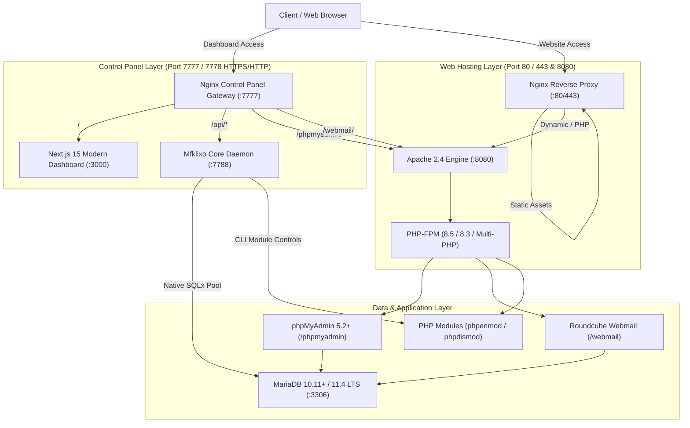

# Mfklixo (Next-Gen Hosting & Cloud Control Panel)


[](LICENSE.txt)
[](https://www.rust-lang.org/)
[](https://nextjs.org/)
[](https://mariadb.org/)
[](https://ubuntu.com/)

> **Mfklixo** is a modern, enterprise-grade, high-performance web hosting control panel evolved from Kloxo-MR. Completely redesigned with a **Rust Core Daemon (`mfklixo-core`)**, a **Next.js 15 responsive UI**, an **`apache_nginx` dual reverse-proxy stack**, native **Multi-PHP & module controls**, and out-of-the-box **phpMyAdmin & Roundcube Webmail** integration.

---

## 🏛️ System Architecture



---

## 🚀 Key Modern Features

### 1. High-Performance Rust Core Daemon (`mfklixo-core`)
- Built with **Rust**, **Tokio**, and **Axum 0.7**.
- Pure native REST API v1 (`/api/v1/`) replacing legacy PHP wrappers.
- Cryptographic **JWT Authentication** seamlessly synced with MariaDB credentials (supporting Bcrypt, MD5, and legacy Kloxo `__lxen:` base64 hashes).
- Live real-time system metrics, disk quotas, process management, and health watchdog.
- Bound safely to `127.0.0.1:7788` with role-based Claims validation for superadmin endpoints.

### 2. Next.js 15 Modern Responsive Dashboard
- Built with **Next.js 15**, **React**, and **Tailwind CSS**.
- Beautiful dark/light mode UI with real-time server health widgets.
- Complete replacement for the 2008-era classic HTML frames interface.

### 3. Integrated Database Manager & Webmail
- **phpMyAdmin 5.2+** available out-of-the-box at `/phpmyadmin/`.
- **Roundcube Webmail 1.6+** available out-of-the-box at `/webmail/`.
- Dual routed: accessible from hosted domains (`http://yourdomain.com/phpmyadmin`) and directly on the panel's secure port (`https://yourserver:7777/phpmyadmin`).

### 4. Multi-PHP Branch & Live Module Controls
- Support for modern PHP versions: **PHP 7.4, 8.0, 8.1, 8.2, 8.3, 8.4, and 8.5**.
- **Live Module Toggle:** Enable or disable PHP extensions (`phpenmod` / `phpdismod`) directly from the panel or REST API without server downtime.
- **Dynamic php.ini Tuning:** Adjust `memory_limit`, `upload_max_filesize`, `post_max_size`, and `max_execution_time` on the fly.

### 5. High-Performance `apache_nginx` Webserver
- **Nginx Front-End (Port 80/443):** Handles SSL termination, gzip compression, and ultra-fast static file serving.
- **Apache 2.4 Back-End (Port 8080):** Handles PHP processing via PHP-FPM, `.htaccess` rewrite rules, and full web application compatibility.

### 6. Completely Decommissioned Legacy Code
- **100% Insecurity Elimination:** Removed all legacy PHP 5.x services (`kloxo-php`, `kloxo-wrap`) and obsolete SUID root binaries, eliminating historical Kloxo vulnerabilities.
- Drastic reduction in memory footprint and CPU overhead.

---

## ⚡ Quick Start: Automated Installation

Install Mfklixo on a fresh Ubuntu (20.04, 22.04, 24.04, 26.04), Debian, AlmaLinux, or Rocky Linux server:

```bash
curl -fsSL https://raw.githubusercontent.com/feizezadeh/Mfklixo/modernize-kloxo/install.sh | sudo bash
```

Or clone the modernized branch and install locally:

```bash
git clone -b modernize-kloxo https://github.com/feizezadeh/Mfklixo.git
cd Mfklixo
sudo bash install.sh
```

---

## 🌐 Default Access Points

| Service | Public Port | Panel Port | URL Path |
| :--- | :--- | :--- | :--- |
| **Modern Dashboard (HTTPS)** | — | `7777` | `https://<SERVER_IP>:7777/` |
| **Modern Dashboard (HTTP)** | — | `7778` | `http://<SERVER_IP>:7778/` |
| **phpMyAdmin** | `80 / 443` | `7777` | `http://<SERVER_IP>/phpmyadmin/` |
| **Roundcube Webmail** | `80 / 443` | `7777` | `http://<SERVER_IP>/webmail/` |
| **Rust REST API Gateway** | `127.0.0.1` | — | `http://127.0.0.1:7788/api/v1/` |

**Default Admin Login:**
- **Username:** `admin`
- **Password:** `admin`

---

## 🛠️ Management & Service Commands

### Service Control
```bash
# Check status of Core Daemon and Panel Web Gateway
sudo systemctl status mfklixo-core kloxo-web

# Restart Core Daemon
sudo systemctl restart mfklixo-core

# Check Hosted Web Services
sudo systemctl status nginx apache2 mariadb
```

### PHP Version & Module Management (CLI & API)
```bash
# List PHP versions
curl -s http://127.0.0.1:7788/api/v1/php/versions -H "Authorization: Bearer <TOKEN>"

# List all PHP modules for PHP 8.5
curl -s http://127.0.0.1:7788/api/v1/php/modules?version=8.5 -H "Authorization: Bearer <TOKEN>"

# Toggle a PHP module (e.g. enable curl)
curl -s -X POST http://127.0.0.1:7788/api/v1/php/modules/toggle \
     -H "Content-Type: application/json" \
     -H "Authorization: Bearer <TOKEN>" \
     -d '{"version":"8.5","module":"curl","enable":true}'

# Switch web engine
sh /usr/local/lxlabs/kloxo/pscript/switchserver --class=web --driver=apache_nginx
```

---

## 📄 License

This project is licensed under the **GNU Affero General Public License v3.0 (AGPLv3)**. See [LICENSE.txt](LICENSE.txt) for details.
